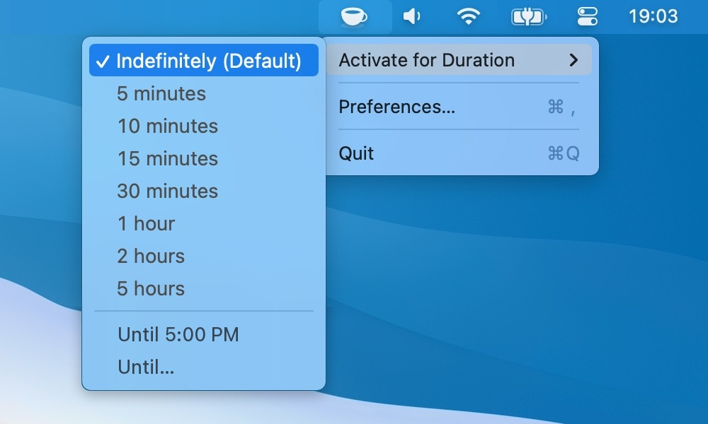

# StayLit

StayLit is a small menu bar utility for macOS *(version 12 and newer)* that keeps your Mac from going to sleep. It can stay on for a set duration, until a time of day, or for as long as it's switched on.

## Installation

StayLit has no published releases yet. Build it from source with Xcode 27.2 (the build command is in [FORK-NOTES.md](FORK-NOTES.md)), then copy `StayLit.app` to `/Applications`.

## How does it work?

StayLit is a small wrapper around Apple's `caffeinate` command line utility, which ships with every current version of macOS. It can also be controlled with `staylit://` URLs (see [Automation](Documentation/Automation.md)).

### Keyboard shortcut

Set a shortcut in *Settings > General* to turn StayLit on or off from any app. It needs ⌘, ⌥ or ⌃, unless it's a function key (F1–F20). Press Delete while recording to remove it.

### Does it work on a MacBook with a closed lid?

No. macOS has *(sensible)* limits here, and heat is a concern, so StayLit only prevents sleep on desktop Macs and on portable Macs with the lid open.

## Is this dangerous?

StayLit won't harm your Mac, because it relies on an official command line tool from Apple. There is no warranty, though, so use it **at your own risk**.

## Contributing

See the [Contribution Guidelines](./CONTRIBUTING.md).

## Credits and License

StayLit is based on [KeepingYouAwake](https://github.com/newmarcel/KeepingYouAwake) by Marcel Dierkes. It is released under the [MIT license](LICENSE), and the original copyright notice is kept.
